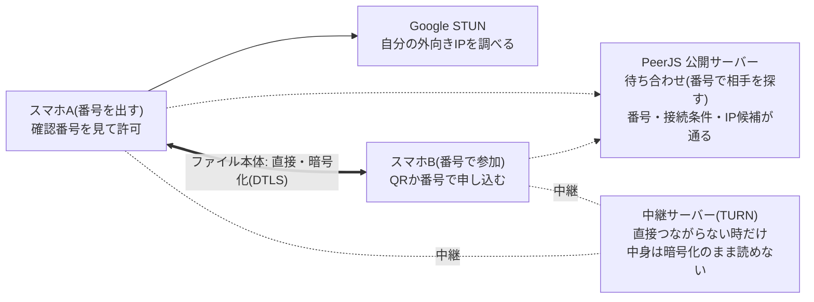

# ファイル転送 設計書

2026-11-06 作成(Claude Docs の設計書から書き出し。以後はこのファイルを正とする)

## 概要

スマホ2台を6桁の番号かQRコードでつなぎ、ファイルをサーバーを通さず端末どうしで直接送るツールです(tools/file-transfer)。

| 項目 | 内容 |
| --- | --- |
| 対象 | スマホ⇔スマホ(同じWi-Fiを推奨)。PCでも動く |
| 送れる物 | ファイルのみ(複数可、双方向) |
| 前提 | 静的サイト(サーバーなし)、https で配信、ページを開いたまま使う |
| 外部サービス | PeerJS 公開サーバー(待ち合わせ)、Google STUN、PeerJS TURN(中継)、jsDelivr / cdnjs(ライブラリ) |
| ライブラリ | PeerJS 1.5.5、qrcodejs 1.0.0 |
| 対応しない物 | ページを閉じた後の再開、オフライン利用 |

## 構成

ファイルは WebRTC の DataChannel で端末どうし直接届き、サーバーは相手探し(PeerJS)と、直接つながらない時の中継(TURN)にだけ使います。

点線は接続の準備でだけ使う経路、細かい点線は直接つながらない時だけ通る中継です。STUN と TURN は PeerJS の標準設定をそのまま使っています([PeerJS util.ts](https://raw.githubusercontent.com/peers/peerjs/master/lib/util.ts))。

| ファイル | 役割 |
| --- | --- |
| file-transfer.html | 画面。CDNの PeerJS・qrcodejs、共通の site.js・tool-kit.js を読む |
| file-transfer.js | 接続、送受信、再接続、画面の更新 |
| file-transfer-core.js | DOMを使わない計算(番号、確認番号、CRC32、圧縮の判断、受け取りの記録)。Nodeでテスト |
| file-transfer.css | 画面の見た目 |
| app-icon-file-transfer.svg | アイコン |

## 接続の流れ

番号を出す側(ホスト)が待ち、番号で参加する側(参加者)が申し込み、ホストが確認番号を見比べて許可した時だけつながります。

1. ホストが6桁の番号を乱数で作り、ID `smartools-ft-<番号>` で公開サーバーに登録する。他人と重なったら(unavailable-id)番号を変えて最大3回やり直す。
2. 番号と、ページのURLに `#<番号>` を付けたQRコードを表示する。参加者は普段のカメラでQRを読むと自動で参加、または番号を手で入れる(全角・空白・ハイフン可)。
3. 参加者がそのIDに接続し(reliable、serialization raw)、`hello`(端末名、圧縮の可否)を送る。
4. 両方の画面に4桁の確認番号が出る。ホストは「〇〇から接続の申し込み」を見て、番号が同じなら「許可する」を押す。
5. ホストが16バイトの乱数で合言葉(token)を作り、`accept` で渡す。以後、再接続の時は合言葉が合えば許可の確認を省く。
6. つながった後はどちらからでもファイルを送れる。参加者のページのURLから `#<番号>` を消し、再読み込みで勝手につながらないようにする。

つながっている間に別の端末から申し込みが来たら `reject`(busy)で断ります。ホストが断った時や時間切れの時も `reject` を送り、参加者は理由ごとの文を出します。

## メッセージ仕様

1本の順番どおり・取りこぼしなしの通信路に、制御はJSONの文字列、ファイルの中身はArrayBufferで流します。形のおかしい制御メッセージは捨てます(parseMsg)。id は常に「送る側が付けた番号」で、受け取る側の番号とは混ぜません。

| t | 向き | 項目 | 意味 |
| --- | --- | --- | --- |
| hello | 参加者→ホスト | name, gzip, token | 申し込み。再接続なら token を付ける |
| accept | ホスト→参加者 | name, gzip, token | 許可。合言葉を渡す |
| reject | ホスト→参加者 | why(busy / timeout / 空) | 断り |
| file | 送る側→受ける側 | id, key, name, size, enc, type | ファイルの始まり。size は元の大きさ、enc が gzip なら区切りごとに圧縮 |
| ready | 受ける側→送る側 | id, from | ここから送ってよい(from バイト目から)。-1 は受け取り済み |
| (バイナリ) | 送る側→受ける側 | 64KB まで | file と end の間に順に届く中身 |
| end | 送る側→受ける側 | id, ok, crc | 送り終え。ok:false は取り消し |
| done | 受ける側→送る側 | id | 受け取り完了(CRCと大きさが一致) |
| bad | 受ける側→送る側 | id | 壊れていた、または展開できなかった |
| cancel | 受ける側→送る側 | id | 受け取りの取り消し |
| ping | 双方 | なし | 5秒ごとの生存確認 |
| bye | 双方 | なし | 「切断」を押した(再接続しない) |

key は「名前・元の大きさ・更新日時・圧縮の有無」をつないだもので、同じファイルを送り直した時に途中まで受け取った分を探すために使います。

圧縮するファイル(file の enc が gzip)では、区切りごとに `blk`(n = 元の大きさ、z = 流す大きさ、gz = 圧縮したか)を送ってから、z バイトのバイナリを流します。file の size は常に元のファイルの大きさです。

## 転送とフロー制御

ファイルは1件ずつ順に、端末から1MBずつ読み出して64KBに切って送り、送り待ちが2MBを超えたら512KBに減るまで待ちます。

| 値 | 大きさ | 理由 |
| --- | --- | --- |
| 送る単位(CHUNK) | 64KB | Safari の1通の上限(256KB)より小さく、往復の回数が増えすぎない |
| 読み出し(READ) | 1MB | `Blob.slice().arrayBuffer()` の呼び出し回数を減らす |
| 止める目安(HIGH) | 2MB | PeerJS が自分でため込み始める8MBより下。生存確認が遅れすぎないようにも小さくする |
| 再開の目安(LOW) | 512KB | `bufferedamountlow` で再開。来ない実装に備え100msごとにも確かめる |

- 受ける側は `binaryType = 'arraybuffer'` にして、届いた順に配列へため、最後に Blob にまとめます(並べ替え不要)。
- 送る側の進みは「送ったバイト数 − 送り待ち(bufferedAmount)」、受ける側は「届いたバイト数」です。
- 速度は直近3秒の区間で計算し、残り時間は「残りバイト数 ÷ 速度」です。表示の更新は200msごとです。
- 転送中は Wake Lock で画面が消えないようにします(断られた時はログに1回だけ記録)。
- 受け取ったファイルは「保存」(ダウンロード)、「共有」(Web Share。iPhoneは写真へ保存可)、「消す」(メモリを空ける)から選びます。

## 中断と再開

切れたら両方が60秒まで自動でつなぎ直し、受ける側が持っているバイト数の続きから送ります。ページを閉じると途中までの分は消えます(メモリにしか置いていないため)。

1. **切れたと判断する時:** 接続の close イベント、または相手から何も届かないまま20秒(生存確認は5秒ごと)。
2. **送る側:** 送りかけのファイルを列の先頭に戻す。受ける側: 受け取りかけの分(partials)を key ごとに残す。
3. **つなぎ直し:** 参加者は同じ番号に合言葉付きの hello を繰り返し送る(待ち合わせサーバーとのつながりも切れていれば作り直す)。ホストは同じ番号で待ち続け、合言葉が合えば許可なしで受け入れる。合わない申し込みは断る。
4. **続きから:** 送る側が file を送ると、受ける側は同じ key の分があれば `ready(from = 届いているバイト数)` を返す。送る側は届いている分を読み直してCRCを計算し、続きから送る。
5. **完了の知らせが届かなかった場合:** done を待っていたファイルも再接続時に列へ戻す。受ける側が受け取り済みなら `ready(from = -1)` を返し、二重に送らない。
6. **60秒で諦めた時:** 接続を終えて最初の画面に戻る。送るファイルは「再送」ボタン付きで残り、もう一度つないで押すと、受ける側の partials がある限り続きから送る。

「切断」を押した時(bye)は再接続しません。その場合も送るファイルは「再送」できる形で止めます。

## 完全性と圧縮

届いた中身は元のデータのCRC32で照合し、文字の多いファイルは1MBの区切りごとにブラウザ標準のgzipストリーム(CompressionStream / DecompressionStream)で圧縮・展開しながら流します。

### CRC32

- 送る側は読み出しながら、受ける側は展開した区切りごとに、元のデータで計算する。end の crc と大きさが両方合えば完了、合わなければ bad を返して「再送」を出す。
- 目的は壊れの検出。わざとの改ざんは暗号化と確認番号で防ぐ。
- 再開した時も全体のCRCになるよう、送る側は届いている分を読み直して計算し、受ける側は途中の値を持ち越す。

### 圧縮(区切りごとのストリーム)

- 対象: 種類が text/、JSON、XML、SVG、または拡張子が txt・csv・json・html・ソースコード・bmp・wav など。1KB未満は対象外、大きさの上限はない。写真・動画・ZIPは縮まないので対象外。
- 両方のブラウザが対応している時だけ使う(hello / accept の gzip)。
- 送る側: ファイルを1MBずつ読み、その区切りを CompressionStream に通す。`blk`(n = 元の大きさ、z = 流す大きさ、gz = 圧縮したか)を送ってから、その分のバイト列を64KBずつ流す。縮まない区切りは元のまま流す。
- 受ける側: z バイトそろったら DecompressionStream で展開し、大きさが n と合うか確かめてためる。展開は非同期なので、区切りの順番が入れ替わらないよう Promise を一本につないで処理し、end はそれが終わってから判定する。
- 区切りが独立しているので、進み具合と再開の位置は元のファイルのバイト数で数えられる。切れた時に途中だった区切りは捨て、その区切りの頭から送り直してもらう。
- 全体をメモリにためて圧縮しないので、圧縮が終わるのを待たずに送り始められる。区切りごとに圧縮し直す分、全体を一度に圧縮するより少しだけ縮みが悪い。
- 完了時の表示は元の大きさでの速度と、実際に流れた「通信量」。

確認: 5MBのCSV(通信量約2.3MB)を2MB届いた所で切り、続きから再開して中身が一致した(PeerJS を偽物にしたブラウザでの試験)。

## セキュリティとプライバシー

中身は常に端末どうしで暗号化され、中間に入られていないことは両方の画面の確認番号で確かめます。

| 対象 | しくみ | 守れるもの / 残る弱点 |
| --- | --- | --- |
| ファイルの中身 | WebRTC の必須の暗号化(DTLS)。鍵は接続ごと | 待ち合わせサーバーも中継サーバーも読めない |
| 鍵のすり替え | 両方の鍵の指紋(SDP の a=fingerprint)を並べ替えてつなぎ、SHA-256 の先頭4バイトから4桁を作る | 番号が同じなら中間者はいない。見比べなければ防げない(4桁なので偶然一致は1万回に1回) |
| 待ち合わせ | PeerJS 公開サーバーへは暗号化された WebSocket | 番号・IPアドレス候補・接続条件はサーバーに見える |
| 番号の推測 | 6桁(100万通り)、使い捨て、10分で無効、許可が必要 | 当てられても許可しなければつながらない |
| 再接続のなりすまし | 許可時に渡す128ビットの合言葉 | 合言葉は暗号化された通信路の中だけを通る |
| IPアドレス | WebRTC の性質上、相手と待ち合わせサーバーに伝わる | 避けられない。注意書きに明記 |
| 受け取った名前 | フォルダの区切り・制御文字を \_ に置き換え、150文字まで | 保存先をずらす名前を防ぐ |
| ログ | 件数、大きさ、時間、端末名(OSとブラウザのみ)だけ | ファイル名・中身・番号・合言葉は書かない |

## タイムアウト一覧

どこで止まったかで案内を変えるため、段階ごとに分けています(file-transfer.js の T\_ で始まる定数)。

| 定数 | 時間 | 場面 | その後 |
| --- | --- | --- | --- |
| T\_SIGNAL | 10秒 | 待ち合わせサーバーにつながるまで | 最初の画面へ、サーバーの問題として案内 |
| T\_CONNECT | 20秒 | 相手の端末と直接つながるまで | 同じWi-Fiにするよう案内。再接続中は次の試みへ |
| T\_APPROVE | 60秒 | ホストが許可に答えるまで | 自動で断る(reject timeout)。参加者は70秒で諦める |
| T\_HOST\_IDLE | 10分 | 番号を出したまま誰も来ない | 番号を無効にし、「出し直す」ボタン |
| T\_PING | 5秒 | 生存確認を送る間隔 | — |
| T\_DEAD | 20秒 | 相手から何も届かない | 切れたとみなして再接続へ |
| T\_STALL | 10秒 | 転送の進みが止まった | 「止まっています」と表示(切りはしない) |
| T\_RECONNECT | 60秒 | 切れた後に自動でつなぎ直す間 | 諦めて「再送」できる形で止める |

生存確認は「相手から何か届いたら生きている」で判断します。受ける側にはファイルの中身が、送る側には相手の ping が届くので、大きな送り待ちがあっても誤って切れたとは判断しません。

## 制限事項・未確認事項・今後の課題

大きな制限は受ける側のメモリで、スマホでは1ファイル数百MB〜1GB程度が目安です。

### 制限事項

- 受け取ったファイルは保存するまでメモリに置く(ディスクへの直接書き込みは未対応)。
- ページを閉じる・再読み込みすると、途中までの分と再開の情報は消える。
- 画面を消す・別のアプリに切り替えると、スマホは通信を止めることがある(Wake Lock で消灶は防ぐ)。
- 1件ずつ順に送る(同時に複数は送らない)。
- PeerJS の公開サーバーと中継サーバーは無保証。止まっている間はつなげない。
- 圧縮は1MBの区切りごとなので、ファイル全体を一度に圧縮するより少し縮みが悪い。

### 未確認事項(実機で確かめるもの)

- [ ] 本物の PeerJS と WebRTC で、同じWi-Fiのスマホ2台がつながるか
- [ ] 確認番号が2台で一致するか
- [ ] 携帯回線どうし(中継サーバー経由)でつながるか、その速度
- [ ] 画面を消した時、Wi-Fi と LTE を切り替えた時の再接続と続きからの再開
- [ ] 許可(60秒)と番号の有効期限(10分)の時間切れ
- [ ] iPhone での「共有」から写真への保存、数百MBのファイルの受け取り

### 確認済み(開発環境)

- 計算部分(file-transfer-core.js)の Node テスト: 番号、端末名、確認番号、CRC32(標準値 cbf43926 と一致)、圧縮の判断、メッセージの確認。
- PeerJS を偽物に差し替えた2つのタブで: 確認番号の一致、CSVの圧縮(488KB→1.2KB)と展開後の一致、6MBを途中で切って続き(3.1MB)から再開し中身が一致、応答なしを20秒で検知して再接続。

### 今後の課題

- 受け取りもストリームのまま保存する(今は展開した区切りをメモリにためて最後にまとめる)。
- PCの Chrome / Edge では File System Access でディスクに直接書きながら受け取る(メモリの制限を外す)。
- 途中までの分を IndexedDB に置き、ページを開き直しても再開できるようにする。
