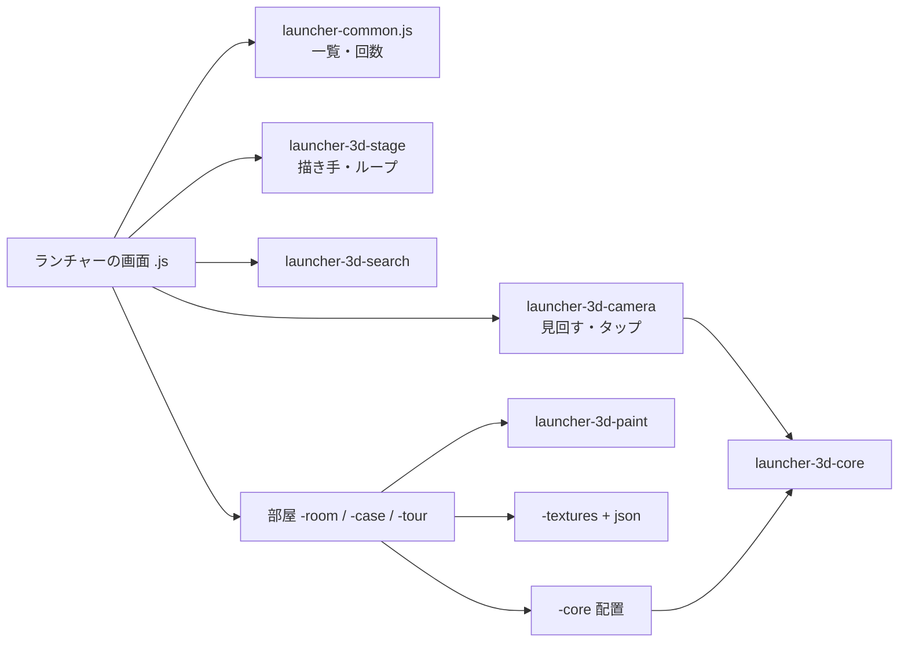

# 3Dランチャー(本棚・美術館) 見直しの設計書

2026-11-07 作成。今の2つの3Dランチャーを読み直して課題を洗い出し、プログラム設計(ソース管理)を組み直す案をまとめる。まだ実装しない(「決めてほしいこと」を決めてから段階ごとに進める)。

## 概要

3Dランチャーは、サイトのツールを3Dの部屋に並べ、タップで選んで開く入口の画面。

- 本棚(`launcher-3d-bookshelf`): 書斎の本棚に、ツールを本として並べる。
- 美術館(`launcher-3d-museum`): 入口ホールからカテゴリごとの展示室に入り、ツールを絵として見る。

前提:

- three.js r128 の非モジュール版を cdnjs から読みます。
- 一覧は `index-data.json`、開いた回数は `launcher-common.js` を使います。
- three.js を読めない時は、2D の一覧に切り替えます。

ランチャーの役目は、ツールを早く見つけて開くこと。3Dは、それを楽しくするための手段です。この順番を崩さないことを、見直しの軸にします。

## 現状

| ファイル | 行 | 役割 |
| --- | --- | --- |
| `launcher-common.js` | 330 | 一覧の読み込み、リンク、アイコン、開いた回数、読み込み中の表示、3Dの共通計算(姿勢・補間・最寄りの角度) |
| `launcher-3d-bookshelf-core.js` | 379 | 本棚の配置とカメラの計算(Node で試せる作り) |
| `launcher-3d-bookshelf-textures.js` (+ `.json`) | 884 | 木・漆喰・布・革・紙・金属・ガラス・水・芝・敷物の絵と、本の背・表紙 |
| `launcher-3d-bookshelf-scene.js` | 1142 | 書斎・本棚・本・照明・昼夜の組み立て |
| `launcher-3d-bookshelf-view.js` | 437 | カメラ、見回し、拡大、タップ判定、描画ループ |
| `launcher-3d-bookshelf.js` | 410 | 画面まわり(一覧・説明カード・ボタン・キー)と起動 |
| `launcher-3d-museum-core.js` | 235 | 展示室の配置とカメラの計算(Node で試せる作り) |
| `launcher-3d-museum-textures.js` | 679 | 絵・案内板・木目・額縁・形状の結合 |
| `launcher-3d-museum-scene.js` | 417 | 展示室の組み立て(壁・通路・ベンチ・額・照明) |
| `launcher-3d-museum.js` | 1153 | 画面・カメラ・状態の保存・部屋の移動・入口ホール・描画ループを全部(大きな `main()` 1つの中) |

3D の部分は合わせて約 5,700 行です。

## 外部設計(使う人から見た)の課題

実機では確かめていない物は「要確認」と書きます。

| # | 課題 | 影響 | 方針 |
| --- | --- | --- | --- |
| E1 | 探す手段が「部屋の中を見て回る」だけで、検索もカテゴリへの近道も無い | ツールが増えるほど目当てが遠くなる(今 約50、増える前提) | 3D の上に「探す」(名前の検索 + カテゴリの近道)を置き、選ぶとカメラがそこへ飛ぶ。2D の一覧も同じ検索を使う |
| E2 | 初回の表示が重い。three.js(約600KB)を読み、数十〜数百枚の絵を Canvas で描く | 古いスマホで待ち時間が長い・発熱(要確認) | 起動の各段階を `log.step` で測る。見えている部屋の絵だけを先に描き、残りは後で描く |
| E3 | 何も動いていない時も、描画ループ(`requestAnimationFrame`)が回り続ける。描くのは変化があった時だけだが、毎フレーム起きる | 待機中の電池 | 止まっている間はループを止め、操作・アニメ・テーマの変化で起こす(Pro と同じ作り) |
| E4 | WebGL のコンテキストが失われた時(iPhone でタブを切り替えた後など)の扱いが無い | 黒い画面のまま戻らない(要確認) | `webglcontextlost` / `restored` を受けて組み直す。だめなら2Dの一覧へ |
| E5 | 画質の決め方が2つで違う。美術館は自前の `isPhone()` と `?q=low`、本棚は画素数の上限だけ | 同じ端末でも重さが違う。規約(判定は `Env`)からも外れる | 画質の段(低・標準・高)を1か所で決め、両方が使う。判定は `Env` と描画の速さの実測 |
| E6 | 操作と画面の部品が、2つで少しずつ違う(説明カード、拡大ボタン、キー、ヒントの出し方) | 乗り換えた時に迷う | 操作表を1つにする(下の「操作の約束」) |
| E7 | 3D は読み上げソフトで使えない。2D の一覧は three.js が読めない時の代わりにしか出ない | 目の見えにくい人、急いでいる人 | 2D の一覧をいつでも開けるボタンにする(今ある一覧パネルを表に出す) |
| E8 | 昼夜のテーマ(部屋の明かり)と、サイトのテーマボタンの関係が2つで違う(要確認) | ボタンを押しても部屋が変わらない、などの迷い | サイトの `data-theme` の変化を合図に、両方とも同じ流れで部屋を切り替える |
| E9 | 本の数・絵の数の上限(`MAX_PER_ROOM` など)を超えた時の見え方が決まっていない | ツールが増えると並びが崩れる(要確認) | 上限と、超えた時の並べ方(棚・部屋を増やす)を core に書き、Node で試す |
| E10 | 画面を開発環境で動かせない(three.js を CDN から読むため) | 変更のたびに実機頼み。壊れても気づきにくい | 計算は core に寄せて Node で試す。画面は「three.js が無い時に2Dの一覧が出る」を smoke で試す(下の「確認」) |

## プログラム設計(ソース管理)の課題

| # | 課題 | 具体例 | 方針 |
| --- | --- | --- | --- |
| P1 | 2つの作りの分け方が違う | 本棚は core / textures / scene / view / 画面の5つ。美術館は view が無く、`launcher-3d-museum.js` 1,153 行にカメラ・状態・移動・描画ループまで入る | 同じ分け方にそろえる(下の「構成」) |
| P2 | 同じ処理が2か所にある | カメラ(`applyCamera` `setZoom` `zoomLabel` `wideLayout` `viewPose` `moveTo` と `FOV` `ZMIN`)、描画ループとリサイズと画素比、Canvas の補助(角丸 `rr`、乱数 `rng`、`tex`、アイコンの読み込み、文字の折り返し)、昼夜の `THEME`、three.js が読めない時の扱い | 3D 共通の部品にして1か所にする |
| P3 | 関数とファイルが大きすぎる | `buildRoom`(本棚)約420行、美術館の `main()` は約1,100行のクロージャ1つで、中の関数を外から試せない | 1ファイル 400 行・1関数 80 行を目安に割る。状態はオブジェクトにして、関数は引数で受け取る |
| P4 | データが JS の中にある(規約: データは `.json`) | 美術館の `THEME` `FRAME_STYLE` `BANNER_COLORS` `ART`、本棚の `THEME` `CAT_HEX` `KINDS`。本棚の質感の見本だけが `.json` | 色・寸法・質感の割り当ては `.json` に出し、起動時に読む |
| P5 | 名前が規約(`docs/naming.md`: 省略しない)に合っていない | `rr` `rng` `tex` `lin` `pr` `cr` `th` `hv` `T` `M` `LOW` `ZMIN` `FOV` `DPR` `favRecs` `rbShared` | 分ける時に、あわせて名前を直す(`roundRect` `randomOf` `textureOf` `pixelRatio` `isLowQuality` …) |
| P6 | 部品の間の結びつきが強い | `MuseumScene.create({…})` に本体の一覧(`roomWalls` `roomSpots` `badgesBySlug`)をそのまま渡して書き換えさせる。`create` の引数が10以上の大きなオブジェクト | 部屋は「組み立てた結果を返す」だけにし、本体の状態を書き換えない(下の「部屋の約束」) |
| P7 | 読み込めなかったファイルの扱いが、サイトの決まりと別 | HTML ごとに `__missing` と `__missingCheck` を手で書く。`launcher-common.js` にも `missingParts` `showMissing` がある | 1つの仕組みにする(`launcher-common.js` の `missingParts` に寄せ、HTML の手書きをやめる) |
| P8 | three.js r128(2021年)に固定 | r160 で非モジュール版(`three.min.js`)が無くなった。上げるには ES モジュール(import map)への移行が要る。色の扱い(r152)と光の強さ(r155)が変わり、見た目も変わる | three.js に触る所を「土台」と「カメラ」に集めてから、上げるかを決める(「決めてほしいこと」1) |
| P9 | 試験が無い | core は Node で試せる作りなのに、`tests/core` に3Dランチャーと `launcher-common` の試験が1つも無い | core と共通の計算に試験を足す。配置の上限(E9)もここで試す |
| P10 | `launchers/` に3つのランチャーの 25 ファイルが平らに並ぶ | どのファイルがどのランチャーの物か、名前を読まないと分からない | ランチャーごとのフォルダに分ける(「決めてほしいこと」3。リンクが変わる) |
| P11 | 想定内の失敗を `log.error` で出している | three.js が読めない時の `fallback()` | 規約どおり `log.warn` にする |

## 構成(見直し後の案)

```
launchers/
├── launcher-common.js              一覧・リンク・アイコン・開いた回数(全ランチャー。今のまま)
├── launcher-3d/                    3D 共通の部品(本棚と美術館が使う)
│   ├── launcher-3d-core.js         姿勢・補間・最寄りの角度・ズームの範囲・画質の段(Node で試す。今 launcher-common にある3Dの計算をここへ)
│   ├── launcher-3d-stage.js        three.js の土台: 描き手の作成・画質・画素比・描画ループ(必要な時だけ)・リサイズ・コンテキスト喪失・後片付け
│   ├── launcher-3d-camera.js       見回す・拡大・タップ判定・移動のアニメ(本棚の view と美術館の中の物を1つに)
│   ├── launcher-3d-paint.js        Canvas の補助: 角丸・乱数・文字の折り返し・アイコンの読み込み・テクスチャにする
│   ├── launcher-3d-search.js       探す(名前の検索・カテゴリの近道。3D と 2D の一覧で共用)
│   └── launcher-3d-quality.json    画質の段ごとの値(画素比の上限・異方性・テクスチャの大きさ・照明の数)
├── launcher-3d-bookshelf/
│   ├── launcher-3d-bookshelf.html / .css / .js     画面と起動だけ
│   ├── launcher-3d-bookshelf-core.js               本の詰め方・棚・部屋の寸法(Node で試す)
│   ├── launcher-3d-bookshelf-textures.js (+ .json) 質感の絵(見本は今の json)
│   ├── launcher-3d-bookshelf-room.js               書斎(壁・床・窓・机・照明)
│   ├── launcher-3d-bookshelf-case.js               本棚と本
│   └── launcher-3d-bookshelf-theme.json            昼夜の色と明かり
├── launcher-3d-museum/
│   ├── launcher-3d-museum.html / .css / .js        画面と起動だけ(300 行目安)
│   ├── launcher-3d-museum-core.js                  部屋の配置・作品の割り振り(Node で試す)
│   ├── launcher-3d-museum-textures.js              絵・案内板・額縁
│   ├── launcher-3d-museum-room.js                  展示室と入口ホールの組み立て
│   ├── launcher-3d-museum-tour.js                  部屋の移動・入口ホール・見た作品の記録
│   └── launcher-3d-museum-theme.json               昼夜の色・額の種類・案内板の色
└── launcher-desktop/ …(3D ではないので今回は触らない。フォルダ分けだけ合わせる)
```



## 仕様

### 部屋の約束(本棚と美術館で同じ形)

部屋を組み立てる部品は、どれも次の物を返します。本体の状態は書き換えません。

| 返す物 | 内容 |
| --- | --- |
| `group` | three.js の Group(シーンに足す) |
| `targets` | タップできる物の一覧 `{ object, kind: 'tool' / 'light' / 'door' …, id }` |
| `poseOf(id)` | その物を正面から見るカメラの姿勢 |
| `update(seconds)` | 動く物を進める。まだ動いていれば true(描画ループを続ける合図) |
| `applyTheme(isDark)` | 昼夜の切り替え |
| `dispose()` | 形・材質・テクスチャを片付ける |

### 操作の約束(2つで同じ)

| 操作 | 結果 |
| --- | --- |
| ツールを1回タップ | 正面へ寄り、説明カードを出す |
| もう一度タップ / カードの「開く」 | ツールを開く |
| 何も無い所をタップ | カードを閉じる |
| ドラッグ | 見回す |
| 2本指 / ホイール / ＋− | 拡大・縮小 |
| 「探す」 | 名前で探す・カテゴリへ飛ぶ |
| 「一覧」 | 2D の一覧(いつでも) |
| ← → / Enter / Esc | 前後のツール / 開く / 戻る |

### 画質の段

| 段 | 画素比の上限 | 異方性 | テクスチャ | 決め方 |
| --- | --- | --- | --- | --- |
| 低 | 1.5 | 2 | 512 | スマホ(`Env`)、または最初の2秒の描画が 30fps 未満 |
| 標準 | 2 | 8 | 1024 | それ以外 |
| 高 | 2 | 16 | 2048 | パソコンで `?q=high` |

値は `launcher-3d-quality.json` に置きます。

### 描画ループ

- 動いている物(カメラの移動・本の出し入れ・照明の変化)がある間だけ回し、止まったら止めます。
- タップ・ドラッグ・リサイズ・テーマの変化で、ループを起こします。

## 処理の流れ(起動)

1. `launcher-common` で一覧を読む。
2. three.js が読めたか確かめる。読めなければ 2D の一覧を出して終わる(`log.warn`)。
3. 画質を決め、土台(stage)を作る。
4. 見えている部屋だけ先に組み立て、表示する。
5. 残りの部屋とテクスチャを後から描く。
6. 各段階を `log.step` で測り、合計の時間をログに出す。

## 進め方(段階)

| 段 | 内容 | 見た目 |
| --- | --- | --- |
| 1 | 3D 共通の部品(core・stage・camera・paint)を作り、2つを乗せ替える。core の試験を足す。読み込みの仕組み(P7)とログ(P11)を直す | 変えない |
| 2 | 美術館の `main()` を画面・部屋・移動に割る。本棚の `buildRoom` を部屋と本棚に割る。データを json へ出し、名前を直す | 変えない |
| 3 | 外部設計の課題: 探す(E1)、描画ループを止める(E3)、コンテキスト喪失(E4)、画質の段(E5)、一覧ボタン(E7)、テーマ(E8) | 変わる |
| 4 | three.js を上げる(決めた場合) | 色と明るさを合わせ直す |

1 と 2 は見た目を変えない作り変えです。画面で確かめられないので、1段ずつ小さく push し、その都度、実機で見てもらいます。

## 確認

- `tests/core/launcher-3d.test.js`: 3D 共通の計算(姿勢・補間・ズームの範囲・画質の段)。
- `tests/core/launcher-3d-bookshelf.test.js`、`tests/core/launcher-3d-museum.test.js`: 配置(ツールが 10 / 50 / 200 個の時、上限を超えた時)。
- `node tests/smoke.js launchers/…`: three.js を止めた状態で、2D の一覧と案内が出ること。開発環境では three.js が読めないので、これが画面の試験の全部になる。
- 実機で、段階ごとに見てもらう:
  - 起動の時間(ログの合計)
  - 見た目が変わっていないこと(1・2の段)
  - タブを切り替えて戻った時(E4)
  - 待機中の電池(E3)

## 決めてほしいこと

1. **three.js を上げるか。**
   - 上げる: ES モジュールに移り、最新の機能と直し(色の扱い・性能)が入ります。代わりに、全部のファイルの読み込み方と見た目の調整が要ります。
   - 上げない: r128 のまま固定します。今は動いていますが、古いまま残ります。
   - 推奨: 段 1・2 で three.js に触る所を集めてから決める。
2. **探す機能(E1)を足すか。** 3D で「眺める楽しさ」を優先し、探すのは 2D の一覧に任せる、という考え方もあります。
3. **ランチャーごとのフォルダに分けるか(P10)。** 分けるとアドレスが変わるので、`launchers.json` を直します。ブックマークしたアドレスは古くなります。
4. **本棚と美術館の両方を続けるか。** 片方に絞ると、手入れの量が半分になります。
