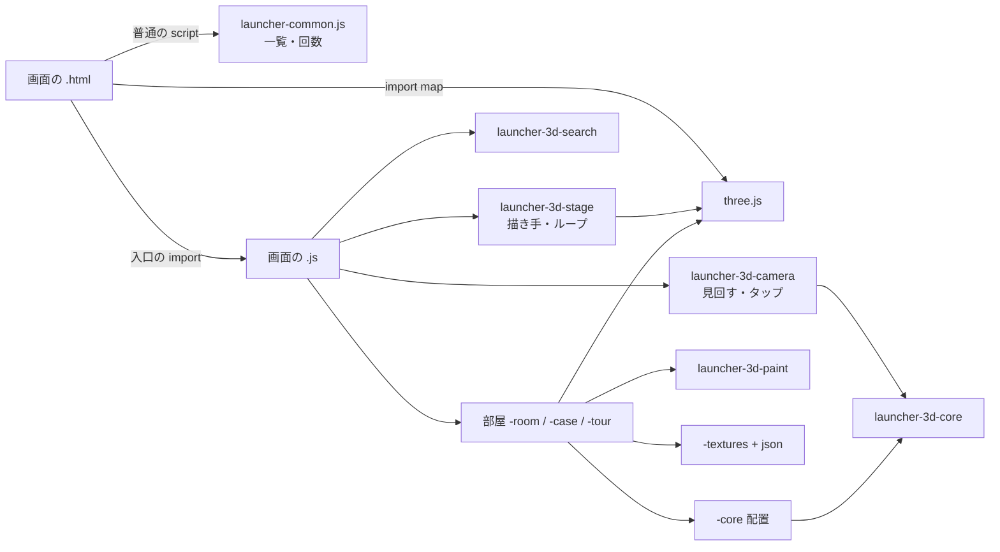

# 3Dランチャー(本棚・美術館) 設計書

2026-11-07 作成、同日に修正版へ書き直し。見直しで決めた方針(ES モジュールの案 C、段階で進める)をもとに、見直し後の形を設計として書く。段 1a は実装済み(下の「実装の記録」)。洗い出した課題は「課題と方針」に残す。

## 概要

3Dランチャーは、サイトのツールを3Dの部屋に並べ、タップで選んで開く入口の画面です。

- 本棚(`launcher-3d-bookshelf`): 書斎の本棚に、ツールを本として並べます。
- 美術館(`launcher-3d-museum`): 入口ホールからカテゴリごとの展示室に入り、ツールを絵として見ます。

ランチャーの役目は、ツールを早く見つけて開くことです。3Dは、それを楽しくするための手段です。この順番を崩さないことを、設計の軸にします。

前提:

- three.js を ES モジュールで読みます。版は import map で固定します(今は r128。上げるかは段 4 で決める)。
- 一覧は `index-data.json` から読みます。開いた回数とリンクは `launcher-common.js` を使います(デスクトップのランチャーと共用)。
- three.js が読めない時や WebGL が使えない時は、2D の一覧に切り替えます。
- import map は Safari 16.4・Chrome 89 以降で使えます。それより古い端末も、2D の一覧になります。

## 課題と方針

見直しで洗い出した課題です。「段」は、下の「進め方」のどこで直すかを表します。実機で確かめていない物は「要確認」と書きます。

### 使う人から見た課題

| # | 課題 | 方針 | 段 |
| --- | --- | --- | --- |
| E1 | 探す手段が「部屋の中を見て回る」だけ。ツールが増えるほど目当てが遠くなる | 3D の上に「探す」(名前の検索 + カテゴリの近道)を置き、選ぶとカメラがそこへ飛ぶ。2D の一覧も同じ検索を使う(足すかは「決めてほしいこと」2) | 3 |
| E2 | 初回の表示が重い。three.js を読み、数十〜数百枚の絵を Canvas で描く(要確認) | 起動の各段階を `log.step` で測る。見えている部屋の絵だけを先に描き、残りは後で描く | 3 |
| E3 | 何も動いていない時も、描画ループが毎フレーム起きる | 止まっている間はループを止め、操作・アニメ・テーマの変化で起こす | 3 |
| E4 | WebGL のコンテキストが失われた時(タブの切り替え後など)の扱いが無い(要確認) | `webglcontextlost` / `restored` を受けて組み直す。だめなら 2D の一覧へ | 3 |
| E5 | 画質の決め方が2つで違う(美術館は自前の `isPhone()` と `?q=low`、本棚は画素数の上限だけ) | 画質の段を1か所で決め、両方が使う。判定は `Env` と描画の速さの実測 | 3 |
| E6 | 操作と画面の部品が2つで少しずつ違う。美術館の入口ホールで、操作のヒントと「エントランスホール」の札が重なる | 操作表を1つにする(「操作の約束」)。重なりを直す | 3 |
| E7 | 3D は読み上げソフトで使えない。2D の一覧は three.js が読めない時にしか出ない | 2D の一覧を、いつでも開けるボタンにする | 3 |
| E8 | 昼夜(部屋の明かり)とサイトのテーマボタンの関係が2つで違う(要確認) | サイトの `data-theme` の変化を合図に、同じ流れで部屋を切り替える | 3 |
| E9 | 本・絵の数が上限を超えた時の並び方が決まっていない | 上限と、超えた時の並べ方(棚・部屋を増やす)を core に書き、Node で試す | 2 |
| E10 | 画面を開発環境で動かせなかった | 解決済み: three.js r128 を git で取り、開発環境のブラウザで動かして、画面を撮って比べる(`docs/lessons.md`) | 1a |

### プログラム設計(ソース管理)の課題

| # | 課題 | 方針 | 段 |
| --- | --- | --- | --- |
| P1 | 2つの分け方が違う。美術館は `launcher-3d-museum.js` 1,151 行に、カメラ・状態・移動・描画ループまで入る | 同じ分け方にそろえる(「構成」) | 1b・2 |
| P2 | 同じ処理が2か所にある(カメラ、描画ループとリサイズ、Canvas の補助、昼夜の色、three.js が読めない時の扱い) | 3D 共通の部品にして1か所にする | 1b |
| P3 | 関数とファイルが大きすぎる(本棚の `buildRoom` 約420行、美術館の `main()` 約1,100行) | 1ファイル 400 行・1関数 80 行を目安に割る。状態はオブジェクトにし、関数は引数で受け取る | 2 |
| P4 | データが JS の中にある(美術館の `THEME` `FRAME_STYLE` `BANNER_COLORS` `ART`、本棚の `THEME` `CAT_HEX` `KINDS`) | 色・寸法・質感の割り当てを `.json` に出し、起動時に読む | 2 |
| P5 | 名前が省略されている(`rr` `rng` `tex` `pr` `T` `LOW` `ZMIN` `FOV` `DPR` …) | 割る時にあわせて直す(`roundRect` `randomOf` `textureOf` `pixelRatio` …) | 1b・2 |
| P6 | 部品の間の結びつきが強い。部屋を作る部品が、本体の一覧を受け取って書き換える | 部屋は「組み立てた結果を返す」だけにする(「部屋の約束」) | 2 |
| P7 | 読み込めなかったファイルを、HTML ごとの手書き(`__missing`)で拾っていた | 解決済み: 入口の `import()` 1つで捕まえる | 1a |
| P8 | three.js r128 の非モジュール版に頼っていた(r160 で無くなった) | 解決済み: ES モジュールにし、版を import map で固定。上げるのは段 4 | 1a・4 |
| P9 | 3D の試験が無かった | 解決済み: 共通の計算と、2つの配置の試験を足した。段ごとに増やす | 1a〜 |
| P10 | `launchers/` に3つのランチャーのファイルが平らに並ぶ | ランチャーごとのフォルダに分ける(「決めてほしいこと」3。アドレスが変わる) | 2 |
| P11 | 想定内の失敗(three.js が読めない)を `log.error` で出していた | 解決済み: `log.warn` にした | 1a |

### 採らなかった案

| 案 | 内容 | 採らなかった理由 |
| --- | --- | --- |
| A | r128 の非モジュール版のまま | 古いまま、直しも新しい機能も入らない。版を上げる道も無い |
| B | three.js だけモジュールで読み、`window.THREE` に置く | 「読めた」合図を別に作る必要があり、読み込み順の管理が二重になる |
| — | common(`log` `Env` `site.js`)もモジュールにする | 全ページに響くため。3D ランチャーの中だけをモジュールにする |
| — | WebGPU にする | 今の場面は軽く、速くなるとは限らない。端末ごとの差もある。`WebGLRenderer` のまま |

## 構成

### ファイル

完成の形です。今あるのは `launcher-3d/launcher-3d-core.js` まで(段 1a)。残りは段 1b・2 で作ります。フォルダ分け(本棚・美術館のフォルダ)は「決めてほしいこと」3 で決まった場合の形です。

```
launchers/
├── launcher-common.js              一覧・リンク・アイコン・開いた回数・読み込み中の表示(全ランチャー。普通のスクリプト)
├── launcher-3d/                    3D 共通の部品(本棚と美術館が使う)
│   ├── launcher-3d-core.js         姿勢・補間・最寄りの角度・ズームの範囲・画質の段の計算(Node で試す)【済】
│   ├── launcher-3d-stage.js        three.js の土台: 描き手・画質・画素比・描画ループ・リサイズ・コンテキスト喪失・後片付け
│   ├── launcher-3d-camera.js       見回す・拡大・タップ判定・移動のアニメ
│   ├── launcher-3d-paint.js        Canvas の補助: 角丸・乱数・文字の折り返し・アイコンの読み込み・テクスチャにする
│   ├── launcher-3d-search.js       探す(名前の検索・カテゴリの近道。3D と 2D の一覧で共用。E1 を足す場合)
│   └── launcher-3d-quality.json    画質の段ごとの値
├── launcher-3d-bookshelf/
│   ├── launcher-3d-bookshelf.html / .css / .js     画面と起動だけ
│   ├── launcher-3d-bookshelf-core.js               本の詰め方・棚・部屋の寸法(Node で試す)
│   ├── launcher-3d-bookshelf-textures.js (+ .json) 質感の絵
│   ├── launcher-3d-bookshelf-room.js               書斎(壁・床・窓・机・照明)
│   ├── launcher-3d-bookshelf-case.js               本棚と本
│   └── launcher-3d-bookshelf-theme.json            昼夜の色と明かり
├── launcher-3d-museum/
│   ├── launcher-3d-museum.html / .css / .js        画面と起動だけ(300 行目安)
│   ├── launcher-3d-museum-core.js                  部屋の配置・作品の割り振り(Node で試す)
│   ├── launcher-3d-museum-textures.js              絵・案内板・額縁
│   ├── launcher-3d-museum-room.js                  展示室と入口ホールの組み立て
│   ├── launcher-3d-museum-tour.js                  部屋の移動・見た作品の記録
│   └── launcher-3d-museum-theme.json               昼夜の色・額の種類・案内板の色
└── launcher-desktop/ …             3D ではないので触らない(フォルダ分けだけ合わせる)
```

### 依存



- `common/` の `log` `Env` `site.js` と `launcher-common.js` は普通のスクリプトのまま先に読み、モジュールの中からは `window` 越しに使います。
- 3D のファイルは、使う物を先頭の `import` に書きます。`<script>` の並び順と `window` の名前に頼りません。
- three.js は、画面の .js だけが動的な `import('three')` で読みます。静的な `import` にすると、three.js が読めない時に 2D の一覧まで出せなくなるためです。ほかのファイルは、土台(stage)を通して受け取ります(段 1b)。

### HTML の読み込み

```html
<script src="../common/log.js"></script>
<script src="../common/env.js"></script>
<script src="../common/site.js"></script>
<script src="./launcher-common.js"></script>
<script type="importmap">
  { "imports": { "three": "https://cdn.jsdelivr.net/npm/three@0.128.0/build/three.module.js" } }
</script>
<script type="module">
  import('./launcher-3d-bookshelf.js').catch(function (e) {
    if (window.Launcher) Launcher.showModuleError(e);
    else log.error('ランチャーの共通ファイル(launcher-common.js)を読み込めませんでした', e);
  });
</script>
```

版の固定は import map の1行です。上げる時は、その1行と色・明かりの合わせ直しになります(段 4)。

## 仕様

### 部屋の約束(本棚と美術館で同じ形)

部屋を組み立てる部品は、どれも次の物を返します。本体の状態は書き換えません。

| 返す物 | 内容 |
| --- | --- |
| `group` | three.js の Group(シーンに足す) |
| `targets` | タップできる物の一覧 `{ object, kind: 'tool' / 'light' / 'door' …, id }` |
| `poseOf(id)` | その物を正面から見るカメラの姿勢 |
| `update(seconds)` | 動く物を進める。まだ動いていれば true(描画ループを続ける合図) |
| `applyTheme(isDark)` | 昼夜の切り替え |
| `dispose()` | 形・材質・テクスチャを片付ける |

### 土台(stage)の約束

| 関数 | 内容 |
| --- | --- |
| `createStage({ THREE, canvas, quality })` | 描き手・シーン・カメラを作る。WebGL が使えなければ例外(画面の .js が 2D の一覧にする) |
| `stage.add(room)` / `stage.remove(room)` | 部屋を足す・外す |
| `stage.wake()` | 描画ループを起こす。部屋の `update` がすべて false を返したら止まる |
| `stage.resize()` | 大きさと画素比を合わせ直す |
| `stage.onContextLost(fn)` | コンテキストを失った時と戻った時に呼ぶ |
| `stage.dispose()` | すべて片付ける |

### 3D 共通の計算(`launcher-3d-core.js`)

段 1a で作った物です。DOM も three.js も使わず、Node で試します。

| 関数 | 内容 |
| --- | --- |
| `randomOf(seed)` | 決まった種から同じ並びを返す乱数 |
| `groupByCategory(list)` | カテゴリごとに分ける |
| `framePose(…)` | 物を正面から収めるカメラの姿勢 |
| `yawToward(…)` / `nearestAngle(…)` | 向く角度、最寄りの角度 |
| `easeInOut(t)` / `interpolatePose(a, b, t)` | 移動のなめらかさ、姿勢の補間 |
| `nextIndex(i, step, length)` | 前後のツール |

段 1b で、ズームの範囲と画質の段の計算を足します。

### 操作の約束(2つで同じ)

| 操作 | 結果 |
| --- | --- |
| ツールを1回タップ | 正面へ寄り、説明カードを出す |
| もう一度タップ / カードの「開く」 | ツールを開く |
| 何も無い所をタップ | カードを閉じる |
| ドラッグ | 見回す |
| 2本指 / ホイール / ＋− | 拡大・縮小 |
| 「探す」 | 名前で探す・カテゴリへ飛ぶ(E1 を足す場合) |
| 「一覧」 | 2D の一覧(いつでも) |
| ← → / Enter / Esc | 前後のツール / 開く / 戻る |

### 画質の段

| 段 | 画素比の上限 | 異方性 | テクスチャ | 決め方 |
| --- | --- | --- | --- | --- |
| 低 | 1.5 | 2 | 512 | スマホ(`Env`)、または最初の2秒の描画が 30fps 未満 |
| 標準 | 2 | 8 | 1024 | それ以外 |
| 高 | 2 | 16 | 2048 | パソコンで `?q=high` |

値は `launcher-3d-quality.json` に置きます。

### 描画ループ

- 動いている物(カメラの移動・本の出し入れ・照明の変化)がある間だけ回し、止まったら止めます。
- タップ・ドラッグ・リサイズ・テーマの変化で、`stage.wake()` を呼んで起こします。

### ログ

- 起動は `起動しました(…)` を1回。各段階は `log.step` で測ります。
- three.js が読めない・WebGL が使えない: `log.warn`(想定内)。
- 自分のファイルが読めない: `log.error`(`Launcher.showModuleError`)。

## 処理の流れ(起動)

1. HTML が common と `launcher-common.js` を読み、入口の `import()` で画面の .js を読む。読めなければ `showModuleError` で理由を出して終わる。
2. 画面の .js が、一覧(`Launcher.loadTools`)と three.js(`import('three')`)を同時に読む。
3. three.js が読めない、または WebGL が使えなければ、2D の一覧を出して終わる(`log.warn`)。
4. 画質の段を決め、土台(stage)を作る。
5. 見えている部屋だけ先に組み立てて表示し、読み込み中の表示を消す。
6. 残りの部屋とテクスチャを後から描く。
7. 合計の時間をログに出す。

## 進め方(段階)

| 段 | 内容 | 見た目 | 状態 |
| --- | --- | --- | --- |
| 1a | ES モジュールにする(three.js は r128 のモジュール版)。3D 共通の計算を `launcher-3d-core.js` へ。読み込みの失敗(P7)とログ(P11)を直す。試験を足す | 変えない | 済 |
| 1b | 土台(stage)・カメラ(camera)・Canvas の補助(paint)を共通にし、2つを乗せ替える | 変えない | 次 |
| 2 | 美術館の `main()` を画面・部屋・移動に割る。本棚の `buildRoom` を部屋と本棚に割る。データを json へ出し、名前を直す。フォルダ分け(決めた場合) | 変えない | |
| 3 | 使う人から見た課題(E1〜E8) | 変わる | |
| 4 | three.js を上げる(決めた場合) | 色と明るさを合わせ直す | |

1・2 は見た目を変えない作り変えです。1段ずつ小さく push し、開発環境で画面を撮って前と比べ、その都度、実機でも見てもらいます。

### 版を上げる時に見た目が変わる所(r128 → r186 以降)

段 4 で、three.js の移行ガイドで1つずつ確かめます。今わかっている大きな物です。

- **色の扱い(r152):** `outputEncoding` / `texture.encoding`(今 `sRGBEncoding` を3か所)が `outputColorSpace` / `texture.colorSpace` に変わる。色の管理が既定で有効になり、昼夜の色を合わせ直す。
- **光の強さ(r155):** 物理的な強さが既定になる。光の `intensity` と `decay` を合わせ直す。
- **WebGL1 の終了(r163):** WebGL2 が要る(Safari 15 以降)。
- **ファイルの形(r171):** `three.module.js` が `three.core.js` を読む2ファイルになる。圧縮前で合わせて約2.1MB。

## 制限事項

- three.js は、縮めていないモジュール版を読むため、約1.14MB です(圧縮前。r128 の縮めた版は約600KB)。起動が遅ければ、jsDelivr の `+esm` を試します。
- 3D は読み上げソフトで使えません。2D の一覧で代わりにします(E7)。
- import map が使えない古いブラウザでは、2D の一覧になります。
- 開発環境の 3D は、ソフトウェアの描画(SwiftShader)です。速さ・発熱・電池は実機でしか分かりません。

## 確認

- Node: `node tests/core.js launcher-3d`、`launcher-3d-bookshelf`(本を 10 / 47 / 200 冊)、`launcher-3d-museum`(配置・部屋の数・扉の割り振り・新着・よく使う物)。
- 画面: `node tests/smoke.js launchers/…`。`node tests/scenarios/launcher-3d.js` は、`THREE_JS_DIR` が無ければ 2D の一覧と警告を、あれば起動のログと本のタップで説明カードが出ることを試す。
- 見た目を変えない段(1・2): 開発環境で three.js r128 を動かし、前と後の画面を 844×390・390×844・1280×800 で撮って、画素が一致することを確かめる。
- 実機で見てもらうこと: 起動の時間(ログの合計)、見た目が変わっていないこと、タブを切り替えて戻った時(E4)、待機中の電池(E3)。

## 決めてほしいこと

決まった物:

1. ES モジュールにする(案 C)。three.js は r128 のまま移し、上げるかは段 4 で決める。

残っている物:

2. **探す機能(E1)を足すか。** 3D は「眺める楽しさ」を優先し、探すのは 2D の一覧に任せる、という考え方もあります。
3. **ランチャーごとのフォルダに分けるか(P10)。** 分けるとアドレスが変わるので `launchers.json` を直します。ブックマークしたアドレスは古くなります。
4. **本棚と美術館の両方を続けるか。** 片方に絞ると、手入れの量が半分になります。

段 2 を始める前に、3 を決めてください。2 と 4 は段 3 の前で構いません。

## 実装の記録

### 段 1a(2026-11-07)

- ES モジュールにしました。three.js は import map で r128 のモジュール版(jsDelivr の `three@0.128.0/build/three.module.js`)に固定しています。
- HTML の `__missing` / `__missingCheck` / `__threeFailed` はやめ、入口の `import()` が失敗した時は `Launcher.showModuleError` で理由を出します。
- three.js は画面の .js の中で `import('three')` で読みます。ほかのファイルは今までどおり `create({ THREE, … })` で受け取ります(段 1b で土台にまとめる)。
- `launcher-common.js` の 3D の計算を `launcher-3d/launcher-3d-core.js` に移し、名前を直しました。各ランチャーの core の中の名前は、段 2 まで今のままです。
- three.js が読めない時と WebGL が使えない時を `log.warn` にしました。
- 試験: `tests/core/launcher-3d.test.js` / `-bookshelf.test.js` / `-museum.test.js`(Node 22 の `require` で ES モジュールを読む)、`tests/scenarios/launcher-3d.js`。
- 確認: 前と後の画面を3つの大きさで撮って比べ、画素が一致しました。実機は未確認です。
