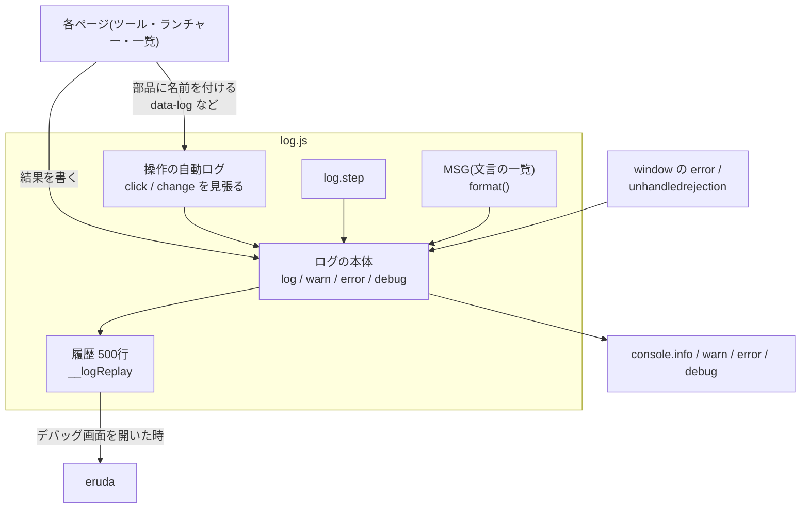

# ログの仕組み 設計書

2026-11-07 作成(実装済みの `common/log.js` から起こしたもの)

## 概要

全ページ(45ツール・3ランチャー・一覧)の操作と結果を、同じ形の日本語の文でブラウザのコンソールに残す仕組みです。スマホで不具合が起きた時に、デバッグ画面(eruda)を開けば「何を押して、何が起きたか」が順に読めることを目的にしています。サーバーには何も送りません。

- 実装: `common/log.js`(1ファイル、約250行)。全ページが `site.js` より先に読み込む。
- 書き方の決まり(ページを書く人向け): [../logging.md](../logging.md)

## 課題と方針

| 課題 | 方針 |
| --- | --- |
| ツールごとに押下ログを手書きすると、書き忘れや文言の揺れが出る | ボタン・選択などの操作ログはページ全体で1か所から自動で書く。ページ側は部品に名前を付けるだけ |
| ログの仕組みが site.js と tool-kit.js に分かれ、ランチャーは自動ログの外だった | `log.js` に集め、全ページで読む |
| 文言がコードの中に散らばり、どんなメッセージがあるか分からない | 文言は先頭の `MSG` に埋め字付きで並べ、`format()` で埋める |
| eruda は開いた後のログしか拾わない | 直近500行を手元に残し、開いた時にまとめて出し直す |
| 個人情報(入力文字・ファイル名・位置)がログに残る | 文字入力は自動ログの対象外。一覧の行は番号で名前を付ける |
| 押下と結果の順番が前後すると読みにくい | 自動ログはキャプチャで動かし、ページ側の処理より先に出す |
| `log.js` が読めないとページが止まる | `site.js` は何もしないログで代わりに動く。各ページの HTML の読み込み確認が案内を出す([page-base.md](./page-base.md)) |

## 構成

読み込み順: `log.js` → `site.js` →(ツールのみ)`tool-kit.js` → 読み込み確認 → ツールのファイル。

## 仕様

### 公開するもの(window.log)

| 名前 | 動き |
| --- | --- |
| `log(msg)` / `log.info(msg)` | info で出す |
| `log.warn(msg, err?)` | warn で出す。err があれば ` [詳細] …` を付ける |
| `log.error(msg, err?)` | error で出す。Error はコンソールの2つ目の引数にも渡す(スタックを開ける) |
| `log.debug(msg)` | debug で出す(細かい内部の状態だけ) |
| `log.step(name, fn, detail?)` | fn を実行して所要時間を測り、成功・失敗を1行で出す。`{ok, value}` か `{ok, error}` を返す |
| `log.MSG` | 文言の一覧(変更不可) |
| `log.format(text, vals)` | 文言の `{キー}` を値で埋める。値の無いキーは空にする |
| `window.__logReplay()` | 履歴をまとめて出し直す(site.js のデバッグボタンが呼ぶ) |

### 1行の形

`2026-11-07 05:00:12.345 「開始」ボタンを押下しました`

時刻はローカル時刻で、年から始まりミリ秒まで(`stamp()`)。Date の標準の書式にはこの形が無いため、数字を桁そろえしてつなぐ。

### メッセージの一覧(MSG)

| キー | 文言 |
| --- | --- |
| pressButton | `{グループ}「{名前}」ボタンを押下しました` |
| pressLink | `{グループ}「{名前}」のリンクを押下しました` |
| press | `{グループ}「{名前}」を押下しました` |
| select | `{グループ}「{名前}」を「{値}」にしました` |
| check | `{グループ}「{名前}」を {値} にしました`(ON / OFF) |
| radio | `{グループ}「{名前}」を選択しました` |
| range | `{グループ}「{名前}」を {値} にしました` |
| color | `{グループ}「{名前}」を {値} にしました` |
| file | `{グループ}「{名前}」でファイルを選択しました({件数}件 / {大きさ})` |
| fileCancel | `{グループ}「{名前}」でファイルの選択をやめました` |
| group | `「{グループ名}」の`(`{グループ}` に入る前置き) |
| stepDone | `{名前}が終わりました({時間}ms)` |
| stepDoneWith | `{名前}が終わりました({詳細} / {時間}ms)` |
| stepError | `{名前}でエラーが発生しました` |
| uncaught | `予期しないエラーが発生しました` |
| unhandled | `未処理の非同期エラーが発生しました` |
| detail | ` [詳細] {詳細}` |
| replay | `--- ここまでの履歴 ---` |

### 自動ログの対象

| 部品 | 契機 | 文言 |
| --- | --- | --- |
| button・`[role=button]` | click(人が押した時だけ) | pressButton |
| `a[href]` | click | pressLink |
| `data-log` を付けた要素 | click | press |
| select | change | select |
| checkbox | change | check |
| radio | change(選ばれた方だけ) | radio |
| range | change(指を離した時) | range |
| file | change | file / fileCancel |
| color | change | color |

対象外: 文字入力(text・number・date など、textarea)、名前の無い部品、`data-log="off"` の中、無効なボタン、プログラムから呼んだ `click()`。

### 名前の決め方

1. `data-log`
2. `aria-label`
3. `<label for>` か、囲む `<label>`(中の入力部品の文字は除く)
4. `title`
5. 部品の文字(input・select 以外)
6. `name`

空白をまとめ、先頭の飾り(●■▶⏸⏹⏺)は文字が残る時だけ外し、24文字で切る。親に `data-log-group` があれば `「…」の` を前に付ける。

スライダーの値: `data-log-value`(画面の文字を使う)→ `data-log-scale`(倍率をかけて四捨五入)→ そのままの値に `data-log-unit` を付ける。

## 処理の流れ

1. `log.js` を読み込むと、`window.log` を作り、`error` / `unhandledrejection` と、`click` / `change` の見張り(キャプチャ)を始める。
2. ページの処理が `log()` などを呼ぶと、時刻を付けてコンソールに出し、履歴(500行まで、古い物から捨てる)に積む。
3. 人が部品を操作すると、ページの処理より先に自動ログが名前を決めて1行出す。続いてページの処理が結果を書く。
4. デバッグボタンを押すと、`site.js` が eruda を読み込み、`__logReplay()` で履歴を出し直す。以後は履歴に積まずコンソールへ直接出す(eruda が拾う)。

## 制限事項

- 履歴は500行まで。それより古い物はデバッグ画面を開いても見えない。
- ページを閉じるとログは消える(保存も送信もしない)。
- キーボード操作、ドラッグ、3D 空間のタップなど、部品ではない操作は自動で出ない。ページ側で書く。
- `stamp()` は端末の時計とタイムゾーンに従う。

## 確認

- ブラウザ(Playwright)で、各部品の自動ログが1回の操作で1行だけ出ること、`log.step` の成功と失敗、警告、予期しないエラー、未処理の非同期エラーの文言とレベルを確かめた。
- ポモドーロタイマー、画像分類、画像ビューア、画像変換、一覧ページ、デスクトップ風ランチャーで動かした。
- 3D ランチャー2つは three.js が開発環境で読めないため、構文チェックのみ。
